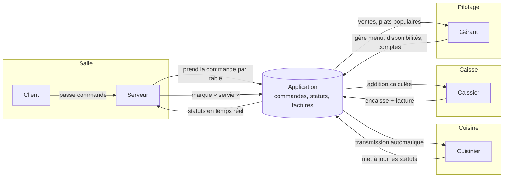

# 03 — Workflow métier (salle → cuisine → caisse)

**Projet :** Chez Mama Rita
**Statut :** 🟡 **À analyser** — aucune version validée
**Dernière mise à jour :** 2026-11-04

## 1. Workflow actuel (tel que décrit par le brief)

🟦 Acteurs : Serveur, Cuisinier, Caissier, Gérant.

🟦 Flux actuel :
1. Le **serveur** prend la commande sur **papier**.
2. Il la transmet **oralement** à la **cuisine**.
3. Le **cuisinier** prépare.
4. Le **caissier** établit la facture manuellement → des erreurs surviennent.
5. Le **gérant** n'a pas de vision consolidée de l'activité.

## 2. Points de friction identifiés

🟦 Transmission orale = perte d'information possible entre salle et cuisine.
🟦 Facturation manuelle = erreurs de calcul / contestations.
🟩 (Recommandation) Le workflow cible devra rendre chaque étape **numérique, traçable et horodatée**.

## 3. Workflow cible — 🟡 À analyser

| Étape | Acteur | Description | Statut |
|-------|--------|-------------|--------|
| 1 | Serveur | Prise de commande par table dans l'application | 🟡 À analyser |
| 2 | Serveur → Cuisine | Transmission automatique de la commande | 🟡 À analyser |
| 3 | Cuisinier | Préparation + mise à jour du statut | 🟡 À analyser |
| 4 | Serveur | Suivi de l'état, service en salle | 🟡 À analyser |
| 5 | Caissier | Facturation automatique + encaissement | 🟡 À analyser |
| 6 | Gérant | Consultation du tableau de bord | 🟡 À analyser |

## 4. Diagramme des acteurs et de leurs interactions (Mermaid)

Légende : 🟦 flux métiers du brief ; les statuts exacts et la règle d'encaissement restent 🟩 (Q2).

## 5. Statuts de commande envisagés — 🟨 Hypothèse à valider

En attente → En préparation → Prêt → Servi → Payé (détails et règles de transition : **À analyser**, dépend de Q2).

## 6. Variantes métier — Non défini (dépend des réponses client)

- Split bill (Q8), annulation de commande (Q10), suppléments (Q9) : **Non défini**.

## 6. Références

- `docs/analyse/01-analyste-metier.md`, `docs/analyse/04-expert-domaine-restauration.md`
